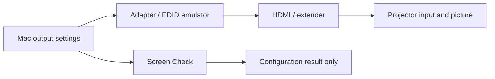

# Screen Check at the show

**Check Now: Command-R · Export: Command-E · Profile: Command-comma**

| What you see | What to do |
| --- | --- |
| All five match | Mac output settings match the approved profile. Confirm the actual picture and projector input separately. |
| MISSING | Check the source-side cable/adapter and Displays settings, then Check Now. An EDID emulator can hide a downstream disconnect. |
| CHECK | Read the row: wrong pixels, scaling, mirroring, refresh, inactive output, extra screen or different identity needs review. |
| UNKNOWN / Check unavailable | Let the connection settle, then Check Now. Export only after a successful fresh read. |
| Report could not be saved | Current readings can still be valid. Check available storage and folder access; an older file may remain. |
| Login checks are off / need approval | Enable at Login under the production user; if needed, use the app's Open Login Settings action. |

The approved seed is four **unscaled, progressive 1920 × 1200** outputs near
60 Hz and one **1920 × 1080** operator monitor. A and D are one two-unit model
group; passing does not identify their physical positions.

Change `show-profile.json` only after an approved hardware/show change. Preserve
a copy first, retain the expected model/count/timing intent, and check the actual
projector input. Do not turn today's incorrect readback into tomorrow's target.

Checks begin at the user's login after boot; they cannot unlock FileVault or
verify a desktop before login. Closing the window keeps the menu-bar checker
running. Quit stops this run; Disable stops future login launches. For an upgrade,
Quit, replace the app, and reopen; the saved profile is retained.

Reports include device identifiers. Check the timestamp before sharing one.
This app never changes resolution, power, input, shutter, focus or playback.
